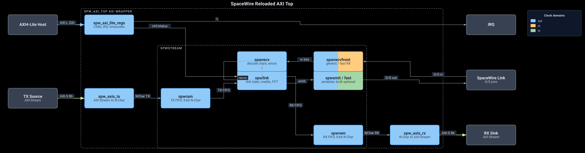

# SpaceWire Reloaded

Author: Leonardo Capossio - [bard0 design](https://www.bard0.com) - hello@bard0.com - 2026

SpaceWire Reloaded is a vendor-neutral SpaceWire link core with AXI4-Lite and AXI4-Stream interfaces, maintained in both VHDL and Verilog and verified in simulation and on FPGA hardware. It is a continuation of Joris van Rantwijk's **SpaceWire Light**: the proven SpaceWire encoder/decoder architecture is kept, the GRLIB-dependent (GPL) AMBA integration is replaced by a from-scratch AXI layer, and the entire core — bus interfaces included — is licensed **LGPL-2.1-or-later**.

The core implements the SpaceWire link layer: data-strobe (DS) encoding, link initialisation and disconnect, credit-based flow control, N-Chars, and TimeCodes. Around it, an AXI4-Lite block exposes control, status, interrupt, and TimeCode registers, while an AXI4-Stream pair moves SpaceWire N-Chars in and out. A complete Arty A7-100T design runs a link in loopback and is validated over JTAG, and a Terasic DE25-Nano (Intel Agilex 5) design runs the same loopback, built with Quartus and validated over JTAG with the same host checks.

## Index

- [Relationship to SpaceWire Light](#relationship-to-spacewire-light)
- [Features](#features)
- [Repository Layout](#repository-layout)
- [System Architecture](#system-architecture)
- [Clock-Domain Crossing and Constraints](#clock-domain-crossing-and-constraints)
- [AXI-Lite Register Map](#axi-lite-register-map)
- [Building and Testing](#building-and-testing)
- [Verification](#verification)
- [Hardware Example: Arty A7-100T](#hardware-example-arty-a7-100t)
- [Hardware Example: DE25-Nano (Agilex 5)](#hardware-example-de25-nano-agilex-5)
- [FPGA Resource Usage and Timing](#fpga-resource-usage-and-timing)
- [License and Credits](#license-and-credits)

## Relationship to SpaceWire Light

SpaceWire Reloaded builds directly on SpaceWire Light by Joris van Rantwijk (2009-2013). The link-layer RTL — `spwlink`, `spwrecv`, `spwxmit`/`spwxmit_fast`, the selectable receive front ends, and the `spwstream` FIFO wrapper — descends from that project and keeps its architecture and behaviour.

What this project changes and adds:

- **Clean licensing.** The GRLIB-dependent AMBA integration and the LEON3/SPWAMBA examples, which pulled in GPL GRLIB source, are removed. A new AXI integration layer is written from scratch for this repository, so the whole tree is LGPL-2.1-or-later with clear provenance.
- **A Verilog core.** The VHDL RTL has a parity-checked Verilog-2001 translation; both languages are maintained together and cross-checked.
- **AXI interfaces.** An AXI4-Lite register block and an AXI4-Stream N-Char data path (dedicated TX and RX bridges) replace the removed AMBA layer.
- **Vendor-neutral integration.** RAM, FIFO, reset, and clock-domain-crossing primitives are wrapped behind portable modules with multi-vendor synthesis attributes and constraint templates.
- **A modern flow.** A Python build/lint/test entry point, GitHub Actions CI, a dual-language cocotb regression, Verilator coverage, synthesis resource reports, and an on-hardware FPGA example.

The original upstream README is preserved verbatim as [README.spacewire_light.md](README.spacewire_light.md); it retains the historical GPL/GRLIB context so the reason for the replacement work stays visible. Those historical GPL references apply only to the removed upstream integration — the current source tree is LGPL.

## Features

- **SpaceWire link layer** — DS encode/decode, the link start/connect/run state machine, disconnect detection, credit-based flow control, N-Chars, and TimeCodes.
- **Selectable front ends** — a generic system-clock receiver and transmitter, plus an oversampled "fast" receiver and a dedicated-clock "fast" transmitter, chosen per instance.
- **Dual language** — VHDL and Verilog-2001, kept in parity with trace, waveform, and manifest cross-checks in CI.
- **AXI4-Lite register block** — link control, live status, sticky errors, interrupts, and TimeCode TX/RX in a 64-byte aperture.
- **AXI4-Stream N-Char path** — TX (sink) and RX (source) bridges that preserve SpaceWire's explicit EOP/EEP characters instead of hiding them in the data byte.
- **Bus-neutral internal split** — the SpaceWire core keeps a simple control/data interface, so further wrappers (AHB/APB, an AXI-DMA data path) can be added without touching the core.
- **Vendor-neutral CDC** — two-flop synchronisers carrying Xilinx/Intel/Lattice/Synplify attributes, with Vivado/Quartus/Lattice constraint templates.
- **Verification** — a dual-language cocotb regression, two-layer AXI protocol checking, SpaceWire exchange-level conformance checks, explicit functional coverage, and Verilator line/branch/expression/toggle coverage.
- **Hardware examples** — an Arty A7-100T loopback design (Verilog and VHDL, Vivado) validated over JTAG, and a DE25-Nano loopback design (Verilog and VHDL, Quartus Prime Pro) for Intel Agilex 5, validated over JTAG (USB-Blaster) with the same fpgacapZero host checks.

## Repository Layout

- `rtl/vhdl`, `rtl/verilog` — the SpaceWire core and AXI wrappers in both languages.
- `bench`, `sim`, `parity` — test benches, simulation setups, and VHDL/Verilog parity material.
- `tests/cocotb` — the cocotb AXI and SpaceWire conformance regression.
- `constraints` — vendor CDC constraint templates.
- `syn`, `scripts` — synthesis wrappers and the resource-report and parity scripts.
- `examples/arty_a7100t` — the Arty A7-100T hardware example.
- `examples/de25_nano` — the DE25-Nano (Agilex 5) hardware example.
- `doc` — the preserved SpaceWire Light manual and architecture documentation.
- `third_party/cocotbext-axi` — vendored AXI BFM fork (git submodule).

## System Architecture

[](docs/architecture.svg)

The AXI wrapper keeps the original `spwstream` data/control split: AXI4-Lite owns CSRs, IRQ, link control, and TimeCodes, while AXI-Stream carries SpaceWire N-Chars through dedicated TX and RX bridges. The diagram opens `spwstream` one level deeper to show the link controller, receiver, selectable RX/TX front ends, and RX/TX RAM-backed N-Char FIFOs.

The AXI-Stream data path is an N-Char stream:

- `tdata[7:0]` carries a data byte, EOP code, or EEP code.
- `tlast` is asserted on EOP/EEP control characters.
- `tuser[0]` is meaningful only when `tlast` is asserted: `0` selects EOP, and `1` selects EEP.

This preserves SpaceWire's explicit EOP/EEP characters and avoids hiding them inside the data byte.

## Clock-Domain Crossing and Constraints

The core runs three clocks: the system clock `clk`, the receive sample clock `rxclk`, and the transmit bit clock `txclk`. Every crossing between them passes through the two-flip-flop `syncdff` synchroniser. The receive buffer head pointer is gray-coded before it crosses from `rxclk` to `clk`, so the system domain can never sample an illegal intermediate pointer value while the pointer increments; the activity counter crosses as binary on purpose because it is only change-detected. The synchroniser flip-flops carry vendor-neutral attributes (`ASYNC_REG` for Xilinx, `syn_preserve`/`syn_srlstyle` for Synplify/Lattice, `preserve` for Intel, plus `keep`) so the same RTL builds correctly across vendors.

CDC timing-constraint templates live in [`constraints/`](constraints/): `spw_cdc.xdc` (Xilinx Vivado), `spw_cdc.sdc` (Intel Quartus), and `spw_cdc_lattice.sdc` (Lattice), with [`constraints/README.md`](constraints/README.md) covering usage and the required `bitrate < rxchunk x sysclk` rate rule. They are validated-intent templates and have not yet been run through the vendor back ends.

## AXI-Lite Register Map

The AXI-Lite control/status block uses 32-bit little-endian registers in a 64-byte (16-word) aperture. All registers return `OKAY` responses; any address outside the aperture (offset `>= 0x40`), and unmapped offsets inside it, read as zero and ignore writes — they do not alias the implemented registers. Hardware reset clears `CONTROL`, `TXDIVCNT`, TimeCode state, sticky errors, and IRQ enable state.

| Offset | Name | Access | Reset | Description |
| --- | --- | --- | --- | --- |
| `0x00` | `CORE_ID` | RO | `0x53505752` | Core identifier, ASCII `SPWR`. |
| `0x04` | `VERSION` | RO | `0x00010000` | Core version. |
| `0x08` | `CONTROL` | RW | `0x00000000` | Link control bits. |
| `0x0C` | `STATUS` | RO | live | Link, FIFO, TimeCode, and error status. |
| `0x10` | `TXDIVCNT` | RW | `0x00000000` | Run-state transmit divider, low byte only. The transmitted bit rate is the active TX clock divided by `TXDIVCNT + 1`. Startup uses the derived 10 Mbit/s divider instead. |
| `0x14` | `TIMECODE_TX` | WO | `0x00000000` | Write bits `[7:6]` control and `[5:0]` time. Writing bit `[31]=1` with byte lane 3 strobed emits a one-cycle TimeCode request. |
| `0x18` | `TIMECODE_RX` | RO/W1C | `0x00000000` | Received TimeCode latch. Bit `[31]` is valid, bits `[7:6]` are control, bits `[5:0]` are time. Write `1` to bit `[31]` with byte lane 3 strobed to clear valid; a simultaneous received TimeCode remains latched. |
| `0x1C` | `ERROR` | RO/W1C | `0x00000000` | Sticky SpaceWire error bits. Write `1` to clear selected bits; simultaneous new errors remain latched. |
| `0x20` | `IRQ_ENABLE` | RW | `0x00000000` | Interrupt enable mask for `IRQ_STATUS`. |
| `0x24` | `IRQ_STATUS` | RO/W1C | live | Interrupt source summary. Bits `[0]` and `[1]` clear the same sticky sources as `ERROR` and `TIMECODE_RX`; bits `[2]` through `[4]` are live level sources. |

`CONTROL` bit fields:

| Bits | Name | Description |
| --- | --- | --- |
| `[0]` | `core_rst` | Hold-style soft reset into the SpaceWire core and AXI-Stream bridges. It stays asserted until software writes this bit back to `0`. |
| `[1]` | `autostart` | Enable automatic link start after a received NULL. |
| `[2]` | `linkstart` | Request link start once the core reaches Ready. |
| `[3]` | `linkdis` | Hold the link disconnected and force a running link to disconnect. |
| `[31:4]` | reserved | Write as zero. |

`STATUS` bit fields:

| Bits | Name | Description |
| --- | --- | --- |
| `[0]` | `started` | Link state machine is in Started. |
| `[1]` | `connecting` | Link state machine is in Connecting. |
| `[2]` | `running` | Link is in Run. |
| `[3]` | `txrdy` | Transmit FIFO can accept an N-Char. |
| `[4]` | `txhalff` | Transmit FIFO is at least half full. |
| `[5]` | `rxvalid` | Receive FIFO has an N-Char available. |
| `[6]` | `rxhalff` | Receive FIFO is at least half full. |
| `[7]` | `timecode_rx_valid` | A received TimeCode is latched in `TIMECODE_RX`. |
| `[8]` | `errdisc` | Sticky disconnect error. |
| `[9]` | `errpar` | Sticky parity error. |
| `[10]` | `erresc` | Sticky escape-sequence error. |
| `[11]` | `errcred` | Sticky credit error. |
| `[31:12]` | reserved | Reads zero. |

`ERROR` bit fields are `[0] errdisc`, `[1] errpar`, `[2] erresc`, and `[3] errcred`. `IRQ_STATUS` uses `[0] any sticky error`, `[1] received TimeCode valid`, `[2] RX valid`, `[3] TX ready`, and `[4] link active`, where link active is `started | connecting | running`. The `irq` output is a level signal: `irq = |(IRQ_STATUS & IRQ_ENABLE)`. Because `IRQ_STATUS[2]`, `[3]`, and `[4]` are live level sources, they deassert only when the underlying condition deasserts or their enable bits are cleared; W1C writes affect only the sticky error and TimeCode-valid sources.

## Building and Testing

Fetch the submodules and install the Python regression dependencies:

```sh
git submodule update --init --recursive
python -m pip install -r requirements-dev.txt
```

Then lint, simulate, and dry-run an FPGA build from a clean checkout:

```sh
python build.py lint
python build.py test
python build.py test --hdl vhdl
python build.py test --runner wsl
python build.py vivado --dry-run
python build.py quartus --dry-run
```

The FPGA flows look for the vendor tools on `PATH` (`vivado`; `quartus_sh`/`quartus_pgm`) and stop with an error naming the missing tool. `python build.py quartus` also accepts `--quartus-bin <dir>` to point at a Quartus `bin64` directory. Build outputs go under vendor folders at the repository root (Quartus: `quartus/`), which are not tracked.

`python build.py test` uses cocotb with `cocotbext-axi`. The regression depends on a small [fork of `cocotbext-axi`](https://github.com/bard0-design/cocotbext-axi/tree/spw-protocol-compliance) that adds an optional AXI handshake protocol checker to the BFMs. It is vendored as the [`third_party/cocotbext-axi`](third_party/cocotbext-axi) git submodule (pinning the exact fork commit) and installed editable from there by `requirements-dev.txt`. Setting `COCOTBEXT_AXI_CHECK_PROTOCOL=1` (the cocotb CI workflow does) enables the checker on every BFM in the run. To use upstream `cocotbext-axi` instead, replace the editable line in `requirements-dev.txt` with `cocotbext-axi` — the fork-specific test skips automatically.

The test runner options:

- `--runner auto`: default; prefers WSL on Windows when a WSL distribution is visible, otherwise uses the local environment.
- `--runner wsl`: run cocotb from WSL with `python3`.
- `--runner local`: run cocotb from the current Python environment.
- `--hdl verilog`: default; run the Verilog cocotb regressions with Icarus Verilog.
- `--hdl vhdl`: run the VHDL AXI leaf/register cocotb regressions with GHDL and cocotb VPI.
- `--hdl all`: run both Verilog and VHDL cocotb regressions.

VHDL cocotb execution requires a simulator/install combination with a working GHDL cocotb VPI interface. The local runner asks `ghdl` for its VPI library directory so Windows installs with split `bin` and `lib` DLL directories can load cocotb's GHDL VPI module. The GitHub Actions cocotb workflow installs GHDL, Icarus Verilog, and `requirements-dev.txt`, then runs both `--hdl verilog` and `--hdl vhdl`.

### Configuration and timing

For Verilog integration, set `SYS_CLOCK_HZ` to the `clk` frequency and `TX_CLOCK_HZ` to the `txclk` frequency when `TXIMPL=1`. The Verilog AXI top and `spwstream` derive the SpaceWire reset window, disconnect timeout, and startup 10 Mbit/s divider from those clock parameters. The raw `RESET_TIME`, `DISCONNECT_TIME`, and `DEFAULT_DIVCNT` parameters are compatibility overrides; leave them at zero for derived, spec-oriented timing.

The SpaceWire standard fixes the link-handshake signalling rate at 10 Mbit/s ±10%. When the startup divider is auto-derived, `spwstream` checks that the effective TX clock has an integer divider inside that window and **aborts elaboration** otherwise (Verilog `$finish`, VHDL `severity failure`). For example a 25 MHz clock has no compliant divider (÷2 = 12.5 Mbit/s, ÷3 = 8.33 Mbit/s) and is rejected; choose a clock such as 20/30/40/50/100 MHz that divides to 10 Mbit/s. The check is gated on the auto-derive path, so it has no effect when a raw `DEFAULT_DIVCNT` override is supplied.

By default the core is a transparent TimeCode pipe (every received TimeCode emits `tick_out`). Setting the `STRICT_TIMECODES` parameter/generic on `spwstream`/`spw_axi_top` to 1 enables the SpaceWire strict reception rule: a received TimeCode emits `tick_out` only when its 6-bit count is exactly the previous count + 1 (mod 64); an out-of-sequence value still updates the local count but does not emit. The received-count register resets to `0x3F`, so a peer counting up from 0 is in sequence from its first TimeCode. The default (0) is unchanged for backward compatibility.

## Verification

### Dual-language cocotb regression

The regression runs the shared AXI tests against the Verilog AXI modules with Icarus Verilog and the VHDL AXI modules with GHDL. AXI-Lite tests use `AxiLiteMaster` for register reads, writes, byte strobes, randomized status/control access, reset recovery, independent AW/W ordering, and channel backpressure. AXI-Stream tests use `AxiStreamSource` and `AxiStreamSink` with pause generators for ready/valid backpressure. The top-level regression loops the SpaceWire physical TX/RX pins back through the real `spwstream` core in both Verilog and VHDL, and covers EOP, EEP, empty packets, multiple back-to-back packets, packet-boundary stalls, reset during streaming, link disconnect/reconnect, and TimeCode transfer through AXI-Lite. It also checks two SpaceWire-semantic properties: that the core is a transparent TimeCode pipe (it forwards any time value verbatim — repeats, wraps, and jumps — with no hardware "previous+1" filter and no master counter, the increment policy being a host concern, and only while the link is in Run state), and that sustained RX backpressure which fills the RX FIFO drives credit-based flow control without losing, duplicating, or reordering any byte once the consumer resumes.

The top-level suite mirrors the original `spwlink_tb_all` configuration sweep: it preserves the original clock, divider, RX implementation, RX chunk, TX implementation, and input-rate table, then runs all 23 configurations through the AXI wrapper in both languages. Loopback-compatible configurations use physical SpaceWire TX/RX loopback through the real core; the high-speed transmitter-only configurations use a cocotb SpaceWire line driver that idles through startup, sends NULLs/FCTs like the original VHDL bench, and checks TX bit timing on the DUT output pins. The external line-driver regression also injects disconnect, double-ESC, parity, and credit-error conditions and checks the AXI-visible sticky error bits, both singly and as a back-to-back burst that re-links cleanly after each of the four error types in succession.

The receive bridge (`spw_axis_rx`) presents `m_axis` through a 1-deep registered (skid) stage whose holding register is reset only by the AXI bus reset, not by the `CONTROL[0]` core soft reset. This keeps AXI-Stream compliant when software soft-resets the core mid-stream: a beat already presented on `m_axis` holds (`TVALID` asserted, payload stable) until `TREADY`, rather than being retracted by the core RX-FIFO flush. The `m_axis_tvalid_not_retracted_by_soft_reset` regression covers it in both languages.

### AXI protocol compliance

Two complementary checker layers run during the regression. The first is a repo-local checker attached to the loopback, register, configuration-sweep, strict-TimeCode, and external-line tests: AXI-Lite channels are checked for ready/valid payload stability under backpressure, `BRESP`/`RRESP` = OKAY, a response only after a matching request, no duplicate address/data acceptance, and a bounded response latency; AXI-Stream channels are checked for resolved `TVALID`/`TREADY`, resolved active payloads, stable payload while stalled, bounded packet length, DUT-output `TVALID` clearing during reset, and the SpaceWire N-Char terminal-beat contract (`TLAST` marks EOP/EEP, terminal `TDATA` is `0` or `1`, and terminal `TUSER[0]` matches the EEP code). It also enforces that a DUT-driven `VALID` (m_axis `TVALID`, AXI-Lite `BVALID`/`RVALID`) never deasserts before its handshake. The converse rule — `VALID` must not *wait* for `READY` — is checked behaviourally by `axi_lite_response_valid_does_not_wait_for_ready`, which drives a write and a read with the response `READY` held low and confirms `BVALID`/`RVALID` rise anyway (a full no-combinational-path proof needs lint/formal, out of simulation scope). Byte-strobe handling is checked exhaustively by `axi_lite_wstrb_honored_for_all_patterns`, which sweeps all sixteen `WSTRB` masks against a scoreboard and confirms only the strobed byte lanes update.

The second layer is the `cocotbext-axi` fork's built-in handshake checker (`check_protocol`): with `COCOTBEXT_AXI_CHECK_PROTOCOL=1` it rides along inside every BFM for the whole run and enforces the generic AXI handshake contract (VALID held until handshake, payload driven and stable while stalled, resolved control) on each channel the DUT drives. Because the "VALID held until handshake" rule is only exercised when READY actually goes low while VALID is high, the configuration sweep and the strict-TimeCode test backpressure every DUT-driven channel (AXI-Lite `B`/`R`, m_axis), so the fork checker verifies response- and stream-channel handshake stability across the whole matrix, not just on the loopback test. The `spw_axi_top_fork_check` regression proves the fork checker catches the soft-reset `TVALID`-retraction violation on the real DUT in both languages (it fails with the pre-fix RTL, passes with the register-slice bridge), and a family of `axi_top_external_line_m_axis_held_survives_*` tests (disconnect, parity, escape, and credit errors) confirms a held m_axis beat under backpressure is not retracted when each kind of external-line error terminates the packet. These are protocol-invariant checks during regression, not a replacement for a future formal proof flow.

### SpaceWire exchange-level conformance

Conformance is checked directly against the transmitted character stream. A cocotb SpaceWire monitor decodes the DUT's `spw_do`/`spw_so` output (a port of the `spwrecv` bit decoder) and the external-line suite asserts: the core emits at least one NULL before any FCT and at least one FCT before reaching Run, and no N-Char/Time-Code before that first FCT (the Rev.1 "Sent NULL"/"Sent FCT" gating); the transmit character priority (a requested Time-Code preempts queued data — Time-Code > N-Char); flow control grants exactly eight N-Chars per received FCT, and EOP/EEP consume credit like data (an undrained EOP burst raises `errcred`); and that random line noise never carries the link to Run — the FSM advances only on decoded NULL/FCT characters (auto-start uses `gotNULL`; raw bit activity, `gotBit`, only feeds the disconnect timer, never the Run transition).

### Coverage

Functional coverage is measured explicitly: `axi_top_external_line_functional_coverage` drives one comprehensive scenario and records a cover-point set — link bring-up reaching `started`/`connecting`/`running`, recovery after an error, all four link errors (`errdisc`/`errpar`/`erresc`/`errcred`), received data character, EOP, EEP, and TimeCode — then prints a coverage report (`covered 12/12 cover-points`) and fails if any point is missed, in both Verilog and VHDL. This is cover-point (functional) coverage, which the Icarus/GHDL flow supports.

RTL line coverage is measured separately with Verilator: `python3 tests/cocotb/verilator_coverage.py` builds the design with `--coverage` across several configurations (generic and fast loopback, external-line error injection, fast-RX sweep cases for the RXCHUNK==1 and high-oversample paths, and the leaf-module unit tests), runs the cocotb regressions against each, and merges the result with `verilator_coverage`; pass `--min PCT` to fail below a floor. The current suite reaches **99.3%** line coverage of the core and AXI wrappers. The runner also parses the raw Verilator coverage data and reports the other point types separately — **branch** (control-flow `cond_then`/`cond_else` arms), **expression** (condition terms), and **toggle** — with a per-file branch breakdown, aggregated per source location (a point counts as covered if any configuration hit it, as the line metric does). Current: **branch 99.6%**, **expression 95.8%**, **toggle 87.8%**. These count each branch arm / expression term, so they are finer-grained than the line metric. The never-taken elaboration guards (the `$display`/`$finish` parameter-range, startup-rate, and `ADDR_WIDTH` checks) are excluded with `// verilator coverage_off`; the only branch arm left uncovered is provably defensive — `spwram`'s `ren` else (the FIFO holds read-enable high). (`spwstream`'s `!rxfull` else, unreachable while a remote respects its credit, is exercised by the credit-underflow error-injection tests, where a credit-violating remote fills the RX FIFO.) Only line coverage is gated by `--min`. The flow needs Verilator >= 5.022 on PATH (Icarus has no coverage support and the installed GHDL uses the mcode backend); because the distribution apt Verilator (5.020) predates the VPI entry points cocotb's Verilator harness calls, the [`Coverage` workflow](.github/workflows/coverage.yml) builds a pinned Verilator from source (cached) and runs this flow with a coverage floor.

## Hardware Example: Arty A7-100T

[`examples/arty_a7100t/`](examples/arty_a7100t/) is a complete hardware-validation design for the Digilent Arty A7-100T (`xc7a100tcsg324-1`). A single `spw_axi_top` link is run in loopback and verified over JTAG with [fpgacapZero](https://github.com/lcapossio/fpgacapZero) ("fcapz"), which is pulled in as a git submodule. The example ships in both Verilog and VHDL.

- Loopback is internal (`spw_do/spw_so` wired to `spw_di/spw_si` inside the FPGA) or external through Pmod JA, selected by the `LOOPBACK_INTERNAL` generic/parameter.
- A small engine (`spw_loopback_axi`) is the AXI-Lite master that brings the link up and reads back the SpaceWire `CORE_ID`, owns the N-Char AXI-Stream for a fabric self-check and a host data-mover, and presents an AXI4 register file to the fpgacapZero EJTAG-AXI bridge. Two ELAs capture the SpaceWire D/S lines and the received byte; two EIOs and the LEDs mirror link/self-check status.
- The same cocotb test drives the engine over its AXI4 slave (exactly as fcapz does) and passes against both the Verilog (Icarus) and VHDL (GHDL) builds; the `fcapz` host script repeats the checks on real hardware.

See [`examples/arty_a7100t/README.md`](examples/arty_a7100t/README.md) for the register map, build, simulation, and hardware-verification steps, plus resource/timing numbers.

## Hardware Example: DE25-Nano (Agilex 5)

[`examples/de25_nano/`](examples/de25_nano/) targets the Terasic DE25-Nano (Intel/Altera Agilex 5 E-series, `A5EB013BB23BE4SR1`) and is built with Quartus Prime Pro. It shows that the core and the `spw_loopback_axi` engine port unchanged from Artix-7 to Agilex 5. The vendor-specific parts sit in two wrappers under `rtl/intel/`, each with behavioral stubs for simulation: the Agilex configuration reset release (Altera Reset Release IP) and the fpgacapZero JTAG debug cores (Intel `sld_virtual_jtag` ELA, EIO and EJTAG-AXI).

- One `spw_axi_top` link in internal loopback, clocked from the board's 50 MHz `CLOCK1_50`, running at 10 Mbit/s (generic RX/TX front ends).
- After configuration (or `KEY0`), the engine brings the link up over AXI-Lite and runs the fabric self-check on its own; `LEDR0`-`LEDR3` show bring-up, link running, self-check done and passed (all four lit = pass). No host is needed.
- With a host, the Arty example's fpgacapZero checks run unchanged over the on-board USB-Blaster III (fcapz `usb_blaster` backend, Quartus `quartus_stp`): identity and `CORE_ID`, self-check counters, host data-mover, TimeCodes, EEP, error injection, fault under load, a PRBS soak and an ELA capture of the D/S lines.
- A board-level cocotb test drives only the real pins (clock, keys) and checks the LEDs, for Verilog (Icarus) and VHDL (GHDL); it is part of `python build.py test`.
- `python build.py quartus` compiles to a `.sof`; `--program` also programs the board over JTAG.

See [`examples/de25_nano/README.md`](examples/de25_nano/README.md) for pins, build, simulation, host verification, and resource/timing numbers.

## FPGA Resource Usage and Timing

Three views are reported: vendor place-and-route numbers from Vivado (Artix-7) and Quartus (Agilex 5), and a fast RTL-level trend metric from Yosys used in CI.

### Vivado place-and-route (Artix-7)

`spw_axi_top` was synthesised and implemented out-of-context for the Digilent Arty A7-100T part (`xc7a100tcsg324-1`; Artix-7, -1 speed grade) with Vivado 2025.2, in both the generic and fast configurations and both languages. The default N-Char FIFOs (`RXFIFOSIZE_BITS` = `TXFIFOSIZE_BITS` = 11, 2048 entries each) infer as block RAM. The three clocks (`clk`, `rxclk`, `txclk`) are true clock-domain crossings and are constrained as mutually asynchronous; the reported Fmax is the achieved post-route maximum on the system-clock domain (worst-case setup, single corner). The flow is reproduced by [`scripts/vivado_resource_ooc.tcl`](scripts/vivado_resource_ooc.tcl), run once per configuration.

| Config | Source | LUTs | FFs | BRAM (RAMB18) | DSP | System `clk` Fmax |
| --- | --- | ---: | ---: | ---: | ---: | ---: |
| generic RX/TX, 20 MHz | Verilog | 365 | 369 | 2 | 0 | 175 MHz |
| generic RX/TX, 20 MHz | VHDL-derived | 358 | 369 | 2 | 0 | 181 MHz |
| fast RX/TX, 50/100 MHz | Verilog | 525 | 548 | 2 | 0 | 171 MHz |
| fast RX/TX, 50/100 MHz | VHDL-derived | 538 | 548 | 2 | 0 | 169 MHz |

The core is small — a few hundred LUTs/FFs and one block-RAM tile (the two RAMB18 are the RX and TX N-Char FIFOs), no DSP — and the two language sources track each other closely. The system-clock domain reaches ~170-180 MHz on this -1 part, comfortably above every SpaceWire operating point (the generic configuration targets a 20 MHz system clock; the fast configuration targets 50 MHz). In the fast configuration the oversampling receive and fast transmit domains close even higher (`rxclk` ~277 MHz, `txclk` ~290-305 MHz), so the system clock is the limiter. These are out-of-context core numbers (no I/O buffers or board constraints); the full-chip Arty design, including the fpgacapZero debug infrastructure, is reported in [`examples/arty_a7100t/README.md`](examples/arty_a7100t/README.md).

### Quartus place-and-route (Agilex 5, full DE25-Nano design)

The complete DE25-Nano example (`spw_axi_top` in the generic configuration, the `spw_loopback_axi` engine, the fpgacapZero ELA/EIO/EJTAG-AXI debug cores and the reset logic, with I/O) was compiled with Quartus Prime Pro 26.1 for `A5EB013BB23BE4SR1` (timing models Preliminary). `clk` is constrained at 50 MHz and JTAG TCK at 24 MHz; the design is fully constrained. Slack is the worst case over all timing corners; Fmax is the Quartus restricted Fmax of the slowest corner.

| Source | Whole design ALMs | Registers | RAM blocks (bits) | DSP | `clk` setup / hold slack @ 50 MHz | `clk` Fmax | of which `spw_axi_top` (ALMs / registers / M20K) |
| --- | ---: | ---: | ---: | ---: | ---: | ---: | ---: |
| Verilog | 4,051 / 46,800 | 6,054 | 5 (86,016) | 0 | +13.520 / +0.031 ns | 154 MHz | 219 / 294 / 2 |
| VHDL | 4,005 / 46,800 | 6,053 | 5 (86,016) | 0 | +13.725 / +0.041 ns | 159 MHz | 232 / 294 / 2 |

Most of the whole-design area is the fpgacapZero debug infrastructure (about 3,100 ALMs); the SpaceWire core itself is about 230 ALMs plus its two FIFO RAMs. The `clk` Fmax is set by the example engine's register-read mux, not the SpaceWire core, and since Quartus only works to the 50 MHz requirement it varies between compiles. Per-entity numbers are in [`examples/de25_nano/README.md`](examples/de25_nano/README.md).

### RTL-level trend metric (Yosys, CI)

For fast language-parity trend tracking without a vendor tool, CI runs:

```sh
python scripts/synth_resource_compare.py
```

These are hierarchical Yosys primitive-cell counts after `proc`, `memory`, and `opt`, with a `ltp` critical-path logic-level count — **not** vendor LUT/FF/RAM numbers (the RAM-backed FIFOs appear here as flip-flops rather than block RAM, which is why the cell/FF counts dwarf the Vivado numbers above). They are cheap to compute in CI and track VHDL/Verilog divergence. The report below was generated with GHDL 4.1.0 and Yosys 0.33 in WSL on 2026-07-07.

| Block | Config | Source | Cells | FF cells | Wires | Wire bits | Memories | Memory bits | Critical path levels |
| --- | --- | --- | ---: | ---: | ---: | ---: | ---: | ---: | ---: |
| AXI-Stream TX bridge | leaf | Verilog | 5 | 0 | 13 | 27 | 0 | 0 | 3 |
| AXI-Stream TX bridge | leaf | VHDL-derived | 5 | 0 | 19 | 47 | 0 | 0 | 3 |
| AXI-Stream RX bridge | leaf | Verilog | 16 | 3 | 23 | 44 | 0 | 0 | 7 |
| AXI-Stream RX bridge | leaf | VHDL-derived | 15 | 3 | 34 | 76 | 0 | 0 | 7 |
| AXI-Lite register block | 8-bit address | Verilog | 107 | 24 | 142 | 658 | 0 | 0 | 27 |
| AXI-Lite register block | 8-bit address | VHDL-derived | 157 | 24 | 342 | 1535 | 0 | 0 | 62 |
| AXI top wrapper | generic RX/TX, 20 MHz | Verilog | 82707 | 36957 | 50213 | 117267 | 0 | 0 | 473 |
| AXI top wrapper | generic RX/TX, 20 MHz | VHDL-derived | 82753 | 36940 | 51226 | 123672 | 0 | 0 | 524 |
| AXI top wrapper | fast RX/TX, 50/100 MHz | Verilog | 83152 | 37081 | 50736 | 118550 | 0 | 0 | 614 |
| AXI top wrapper | fast RX/TX, 50/100 MHz | VHDL-derived | 83132 | 37020 | 52420 | 129958 | 0 | 0 | 824 |

## License and Credits

- **License:** LGPL-2.1-or-later for the entire core, AXI interfaces included. Full text in [LGPL-2.1.txt](LGPL-2.1.txt); every source file carries an `SPDX-License-Identifier: LGPL-2.1-or-later` tag.
- **Author:** Leonardo Capossio - [bard0 design](https://www.bard0.com) - hello@bard0.com
- **Based on:** SpaceWire Light by Joris van Rantwijk (2009-2013), preserved as [README.spacewire_light.md](README.spacewire_light.md).
